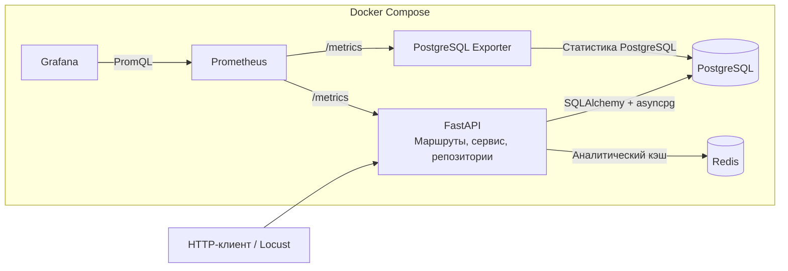
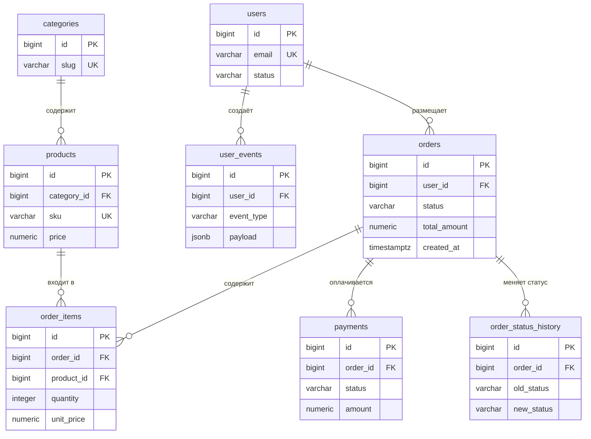
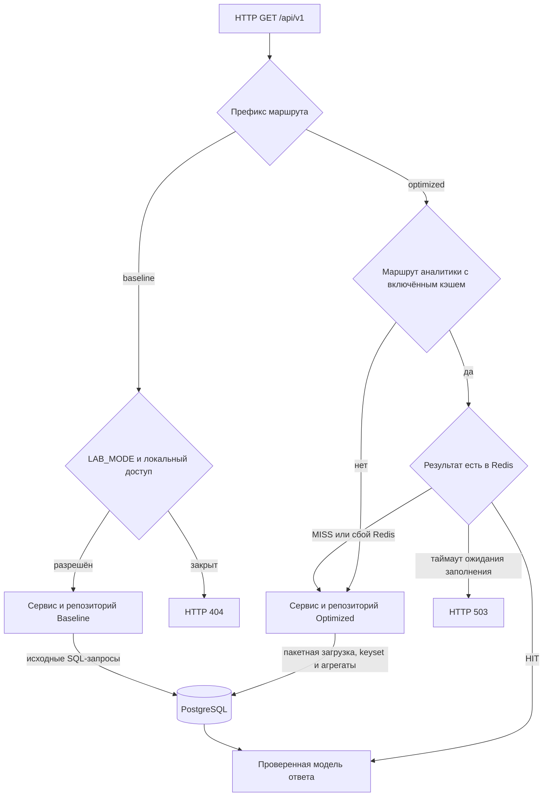
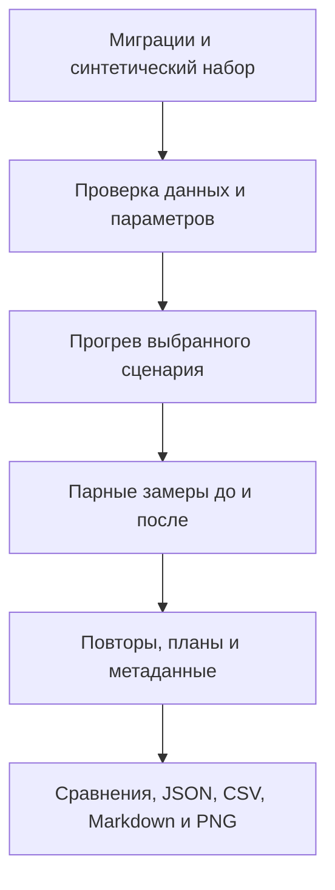

# Архитектура PostgreSQL Performance Lab

## Системная архитектура

API, PostgreSQL и Redis запускаются в основном профиле. Профиль `monitoring` добавляет три сервиса мониторинга и одноразовую инициализацию роли Exporter. [Запуск и порты](monitoring.md)

## ER-диаграмма PostgreSQL

На диаграмме показаны связи и ключевые поля прикладных таблиц. Манифест синтетического набора хранится в отдельной схеме `lab_data`. [Типы и ограничения](database.md)

## Потоки Baseline и Optimized

При успешном MISS аналитический результат сохраняется с TTL. Для Baseline и Optimized интеграционные тесты сверяют форму и значения ответов. [Оптимизации](optimization.md) · [Кэширование](redis-cache.md)

## Выполнение бенчмарка

Эксперименты SQL и HTTP имеют разные границы замера. Для Locust каждый вариант запускается с одинаковым числом пользователей и ограничениями времени и запросов. Входы генератора отчётов выбираются явными путями. [Методика Locust](benchmarking.md) · [Форматы отчётов](reporting.md)
